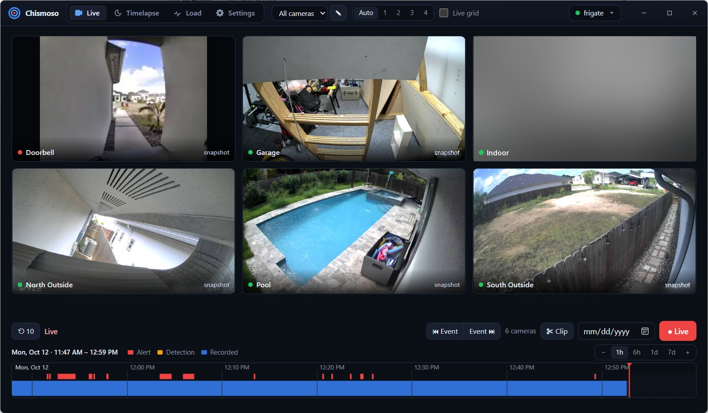

# Chismoso

A small desktop app for [Frigate NVR](https://frigate.video), for Windows, macOS and Linux. Not affiliated with the Frigate project.

I mainly wanted an easy way to turn a day of camera footage into a short timelapse. That works now. Along the way it picked up live view, a recordings timeline, clips and notifications too.



**Download:** [Windows, macOS and Linux](https://chismoso.caprichosos.org/download.html), or grab a file from the [latest release](https://github.com/DanielGarc/chismoso/releases/latest). It's a beta and the installers aren't code-signed yet, so Windows and macOS will ask you to confirm the first time.

- **Timelapses and exports.** Pick cameras and a time range, then make a timelapse at any speed (2×–3600×) or a real-time clip. Frigate renders it, and the app downloads it, can delete the server copy, and plays exports in-app.
- **Live view.** A grid of cameras (snapshots, or live video) using Frigate's camera groups or your own layouts, and a full live view per camera with detect/record/snapshot switches. Live video tries WebRTC first, then MSE, then 1 fps snapshots, so something always shows.
- **Recordings timeline.** Under the grid and under each camera is a bar you can zoom from weeks down to seconds, with alerts and detections marked on it. Click anywhere to play from that moment: one camera, or every camera in the layout in sync. A speed slider goes from −16× (reverse) to 16×.
- **Clips.** Select a stretch of the bar to save it as a clip (one per camera) or start a timelapse from it.
- **Notifications.** Native desktop notifications for new Frigate alerts (and optionally detections), per camera, with a cooldown, and a snapshot of the person when one is detected.
- **Load.** What the app asks of your Frigate server right now, and a 24-hour trend kept on this computer.
- **Settings.** System stats (detector speed, camera fps, disk, GPU) and Frigate's `config.yml` editor, with validation, save, save & restart, and restart.
- **Command line.** The same export engine without the window, for scripts and scheduled jobs.

It's built with [Tauri 2](https://tauri.app): a Rust backend plus the operating system's own web view. The installer is under 10 MB, and there's no Electron or bundled browser.

## Using it

Sign in with your Frigate address and account:

| Address | Username | Notes |
|---|---|---|
| `https://your-frigate:8971` | your Frigate user | With Frigate's default certificate, press **Trust and connect** when asked. The certificate is pinned, and you're warned if it changes. |
| `http://your-frigate:5000` | leave empty | Internal port with no login. Only use it on a network you trust. |

The address, username and options are remembered. **The password is never stored.**

Editing the config needs an **admin** account. Viewers can still watch cameras and make exports.

### Getting the best live video

| Method | When it's used | What it needs |
|---|---|---|
| **WebRTC** | Windows and macOS | Port **8555** (TCP and UDP) reachable from this computer, plus Frigate's `go2rtc.webrtc.candidates` set to the Frigate host's LAN IP, e.g. `192.168.1.169:8555`. |
| **MSE** | Linux (WebKitGTK has no WebRTC), or when WebRTC fails | Nothing extra. It runs over the same HTTPS port as the app. |
| **Snapshots** | Last resort | Nothing. About one frame per second. |

Badges in the live view show which method is active and the frame rate you're actually getting, measured from the video itself. (Frigate's own `camera_fps` is the *detect* stream's rate, often 5 fps; it's in the tooltip, and it doesn't limit live view.) Away from home, MSE usually works where WebRTC's UDP port doesn't.

If a camera has a second stream in `live.streams` (for example a substream), the grid uses it to save bandwidth. The full view lets you switch between streams.

### Recordings timeline

The bar sits under the camera grid and under each camera. In the grid it covers every camera in the layout: clicking it plays all of them from that moment, kept in step with each other (a camera with no footage at that moment says so and joins in when its footage starts). Click a tile while playing back to open that camera at the same moment, and **← All cameras** takes the whole grid back to it.

| Action | What it does |
|---|---|
| Scroll (or pinch) | Zoom around the pointer, from weeks down to ~20 seconds across the bar |
| Drag | Move back and forth in time |
| Click | Play from that moment (in a gap, it plays from the next footage) |
| ← / → | Jump 10 seconds |
| Space or K | Pause and resume |
| J / L | One speed step slower / faster. Past 1× to the left plays backwards (from live, J starts reverse playback from now) |
| Speed slider | −16×, −8×, −4×, −2×, **1×** (centre), 2×, 4×, 8×, 16×. Double-click for 1× |
| [ / ] | Previous / next alert or detection |
| Hover a marker | Thumbnail of the event; click it to play from just before |
| Shift-drag, or ✂ Clip | Select a range: play it, save it as a clip, or make a timelapse of it |
| Date box | Jump to a day |
| **Live** | Back to the live stream |

Blue is recorded footage and dark gaps are missing footage. Red marks are alerts and amber marks are detections; new ones appear within a couple of seconds, pushed over Frigate's WebSocket. The red line is the playhead. When zoomed out past three days, the bar uses Frigate's hourly summary, with brighter blue meaning more of that hour was recorded. Playback needs Frigate 0.17 or later.

Under the hood it's light: the bar asks Frigate for one day of recordings at a time and caches it. Rust merges Frigate's ~8,600 ten-second segments per day into a handful of spans before the UI sees them. Playback uses Frigate's own HLS stream (fragmented MP4), fed straight into the web view's video player, with no video library. Browsers can't play video backwards, so reverse playback steps the picture back several times a second and fetches earlier segments ahead of it. It's smoothest on Windows and macOS; on Linux (WebKitGTK) reverse on a grid of many cameras can stutter, and one camera at a time works best. Playing back a whole grid fetches every camera's recording at once, so expect proportionally more load on Frigate than a single camera.

### Notifications

**Settings → Notifications** turns on native notifications for new alerts (with a snapshot of the person when one is detected; or for every alert, or never), optionally detections too, for all cameras or the ones you pick, at most one per camera per cooldown. They come from one WebSocket to Frigate's `/ws` while the app is running (no MQTT broker needed); the same connection keeps open timelines current. Use **Send a test notification** to check your system allows them (on macOS, allow the app under System Settings → Notifications). On Windows the app registers its own name and icon for notifications at startup (per user, under `HKCU\Software\Classes\AppUserModelId\org.caprichosos.chismoso`), so they don't show up as "Windows PowerShell" even when you run the `.exe` without installing it.

### Timelapses

- **Target length or speed.** Pick how long the finished video should be (15 s to 10 min) and the app works out the speed, or set the speed directly. **1440×** turns a day into a minute.
- **Fast or Smooth render.** Fast makes Frigate decode only keyframes (about one every 1–2 s of footage) instead of every frame. In testing that was **11× quicker** with an identical result. It's the default, and the app warns you below 60×, where motion can look jumpy. Smooth decodes every frame.
- **Parallel.** All selected cameras are sent at once. Frigate renders up to `record.export.max_concurrent` (3 by default) at the same time; raise it in the config if your server has headroom.
- Progress shows elapsed time and an estimate of the time left for each camera.

Frigate 0.17+ supports any speed. Older versions only offer 25×, and the app tells you if that's the case.

### Load on your Frigate server

The **Load** tab shows, for the last minute: requests and data this app pulls from Frigate, live streams open, Frigate's server CPU, and go2rtc viewers from every client. Below are 24-hour trends of the same numbers (1 h / 6 h / 24 h), recorded once a minute while the app is open and kept in local storage per server; gaps are times the app was closed. It also says whether this computer decodes video in hardware, and on Linux what to install if it doesn't.

What the app does to stay light:

- Live streams close after the window has been minimised or hidden for 30 s, and reopen when it's back. Tiles scrolled out of view don't stream or fetch snapshots.
- Snapshot tiles ask Frigate for the size they're shown at, not a fixed size.
- Grid playback plays at most 4 cameras at once (each pulls a full-resolution recording); the rest show a still from the recordings every few seconds and start playing when clicked.
- Opening a camera from a live tile reuses the tile's WebRTC connection when it's the same stream, and hands it back when you return.
- The timeline only repaints when something on it moved.

## Command line

Any argument switches to command-line mode (on Windows, run it from a terminal):

```sh
# list cameras
chismoso --url https://frigate.local:8971 --user admin --insecure --list-cameras

# a 1440× timelapse of yesterday for two cameras, removing the server copies afterwards
FRIGATE_PASSWORD=... chismoso --url https://frigate.local:8971 --user admin --insecure \
  --camera pool --camera north_outside \
  --start "2026-10-10 00:00" --end "2026-10-11 00:00" \
  --speed 1440 --out ~/Videos/Frigate --delete-after
```

`chismoso --version` prints the version, commit and build date. `chismoso --help` lists every option (`--realtime`, `--smooth`, `--fps`, `--camera all`, `--list-exports` and more). Cameras render in parallel, and speeds of 60× and up use keyframe-only decoding unless you pass `--smooth`. The exit code is 0 on success, 1 if any export failed, and 2 for usage or connection errors.

## Building

You need [Rust](https://rustup.rs) (stable), plus:

- **Linux:** `sudo apt install libwebkit2gtk-4.1-dev libappindicator3-dev librsvg2-dev` (Debian/Ubuntu). For video playback, also install `gstreamer1.0-plugins-good gstreamer1.0-plugins-bad gstreamer1.0-libav`.
- **Windows:** Visual Studio Build Tools (C++). WebView2 is already part of Windows 10/11.
- **macOS:** Xcode command-line tools.

```sh
cd src-tauri
cargo run              # development build
cargo build --release  # optimized binary in src-tauri/target/release/
```

For installers (`.msi`/`.exe`, `.dmg`/`.app`, `.deb`/`.rpm`/`.AppImage`), install the Tauri CLI with `cargo install tauri-cli --version "^2"`, then run `cargo tauri build` from the project root.

**Mobile:** see [docs/PLATFORMS.md](docs/PLATFORMS.md#running-each-platform) for Android and iOS (`cargo tauri android dev`, `cargo tauri ios dev`). They compile today; they haven't been run on a device yet.

**Checks:** `.github/workflows/check.yml` lints and tests every platform (Linux, Windows, macOS, Android, iOS) on each push. Locally, `sh dev/cross-check.sh` covers Linux, Windows and Android from a Linux machine.

**Releases:** Actions → **Bump version and release** sets the version, tags it and builds Windows, macOS (Apple Silicon + Intel) and Linux installers into a GitHub release, with a signed `latest.json`. Installed copies check it once a day and offer **Update and restart**. The updater's signing key goes in the repo secrets `TAURI_SIGNING_PRIVATE_KEY` / `TAURI_SIGNING_PRIVATE_KEY_PASSWORD`; its public half is in `tauri.conf.json`. The website (`site/`, deployed by `pages.yml`) reads download links from the latest release.

macOS builds aren't code-signed. The first time, right-click the app and choose **Open**, or run `xattr -dr com.apple.quarantine "/Applications/Chismoso.app"`.

## Developing without cameras

`dev/mock_frigate.py` is a small stand-in for Frigate. It has login, cameras, stats, snapshots, a real WebRTC peer, an MSE stream, a week of recordings with gaps (and HLS playback), exports with progress, and config editing.

```sh
pip install aiohttp aiortc
sh dev/make-mock-media.sh
python3 dev/mock_frigate.py          # http://127.0.0.1:5055, no login
python3 dev/mock_frigate.py --tls    # https://127.0.0.1:5443, self-signed, admin / password
```

## How it fits together

One codebase for desktop and (soon) mobile; **read [docs/PLATFORMS.md](docs/PLATFORMS.md) before adding a feature**. In short: OS-specific code lives only in `src-tauri/src/platform/`, and the UI asks `Platform.has("…")` instead of checking the OS.

```
ui/                    the interface (plain HTML/CSS/JS, no build step)
  platform.js          what this device can do; compact (phone) layout switch
  app.js               screens: login, live grid/focus, exports, load, settings
  webrtc.js            WebRTC and MSE live players, and the fallback order
  timeline.js          zoomable recordings bar (canvas; mouse, trackpad, pinch)
  playback.js          recordings player (HLS/fMP4 → MediaSource, reverse) and multi-camera sync
src-tauri/src/
  lib.rs               the app (shared by desktop and mobile)
  main.rs              desktop entry: command-line mode, then the window
  commands.rs          everything the UI calls
  platform/            desktop.rs and mobile.rs: notifications, files, window setup, decoding check
  frigate.rs           Frigate API client (login, cameras, exports, config, stats, WebRTC signaling)
  jobs.rs              export pipeline: queue → wait for render → download → optional cleanup
  mse.rs               go2rtc MSE WebSocket (fMP4) → raw bytes to the UI; /ws commands
  notify.rs            Frigate /ws watcher: alerts → notifications + live timeline updates
  media.rs             private local HTTP server for snapshots, recordings and videos
  tls.rs               certificate checks and pinning (ring)
  about.rs, metrics.rs name/version; load counters
  cli.rs               command-line mode (desktop only)
dev/                   mock Frigate server, cross-platform lint script
docs/PLATFORMS.md      the desktop/mobile contract, run instructions, feature matrix
```

How the pieces talk to Frigate:

- **Login and certificates live in Rust.** The web view never talks to Frigate directly, so Frigate's self-signed certificate and auth cookies are never a problem.
- **WebRTC:** the offer/answer exchange goes through Rust (`/api/go2rtc/webrtc`). Video then flows straight from go2rtc to the web view.
- **MSE:** Rust opens `/live/mse/api/ws` and passes fragmented-MP4 segments to the page over a binary channel.
- **Snapshots and export videos:** served by a local HTTP server on `127.0.0.1`, with a random port and a random secret in every URL, so other programs on the computer can't use it. It supports byte ranges, so seeking in videos works.

## Version

The version lives in `src-tauri/Cargo.toml` (Tauri reads it from there). Builds are stamped with the git commit and build date, shown under **server menu → About** (with a **Copy version info** button for bug reports), on the sign-in screen, and by `--version`. Set `SOURCE_DATE_EPOCH` for reproducible build dates.

The name is a working title. It's defined once in `src-tauri/src/about.rs` (`NAME`) plus `productName` in `tauri.conf.json`; the UI picks it up from there.

## Not yet included

- Two-way talk (the doorbell intercom). go2rtc supports it, so it's a natural next step.
- PTZ controls.
