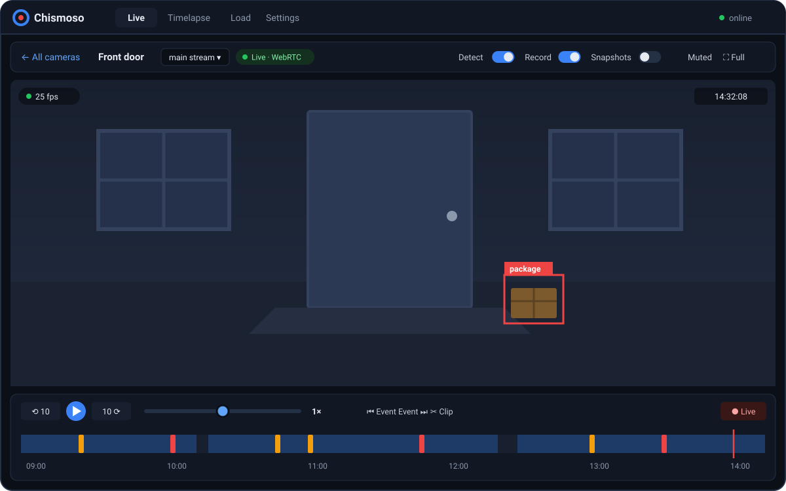

Click any tile in the grid to open that camera on its own. The bar above the picture holds everything for that camera.

## The controls

| Control | What it does |
|---|---|
| **← All cameras** | Back to the grid (or press <kbd>Esc</kbd>) |
| **Stream picker** | Choose between the camera's live streams, if it has more than one |
| **Badge** | How you're watching: `Live · WebRTC`, `Live · MSE`, `Snapshots · 1 fps`, or a recording |
| **Detect / Record / Snapshots** | Turn those Frigate features on or off for this camera |
| **Snapshot** | Save a full-size picture; see [Snapshots](#snapshots) |
| **Muted** | Turn the camera's sound on or off |
| **Full screen** | Fill the screen with the picture |

The timeline under the picture covers just this camera. Click it to play this camera's recordings; see [Recordings timeline](timeline.md).

## Choosing a stream

If the camera lists several streams under `live.streams` in Frigate's config, a picker appears next to the name. The grid uses the second stream (usually the substream) to save bandwidth; here you can switch to the main stream for full detail, or stay on the substream over a slow connection.

## Camera switches

The **Detect**, **Record** and **Snapshots** switches change what Frigate does for this camera, straight away.

- They need an **admin** account. For viewers they're shown but disabled.
- They last **until Frigate restarts**. To make a change permanent, set it in `config.yml` ([Settings](settings.md#configuration-editor)).

The same switches for every camera are on the [Settings](settings.md#camera-switches) tab.

## Moving a PTZ camera

For cameras that can pan, tilt or zoom, and that Frigate controls over ONVIF (`onvif:` in the camera's Frigate config), a set of controls appears in the corner of the live picture:

- **Arrows**: hold to pan and tilt; let go to stop. On a computer, <kbd>Shift</kbd> plus the arrow keys does the same.
- **+ / −**: hold to zoom.
- **Presets**: jump to a position saved on the camera.
- **Double-click the picture** to centre the camera on that spot, when the camera supports it.

The controls only show while watching live, and only on cameras that Frigate reports as movable. Cameras that don't speak ONVIF (Wyze, for example, with its stock firmware) can't be moved this way.

## Snapshots

**Snapshot** saves a full-size picture from this camera to your exports folder: the live image, or, while you're playing a recording, the moment on screen. A note pops up with **Share…**, **Copy**, **Open** and **Show in folder**, so you can send it straight away (see [Sharing](clips-and-timelapses.md#sharing)). Files are named after the camera and the time, like `garage 2026-10-12 21-30-05.jpg`.

## Sound

Live video starts muted. Press **Muted** to hear the camera, if it has audio. It only makes a difference on cameras whose stream carries sound.

## Full screen

**Full screen** fills the screen with the camera. Press <kbd>Esc</kbd> to leave. To make the whole app window full screen instead, use <kbd>F11</kbd> or **Full screen** in the server menu.
