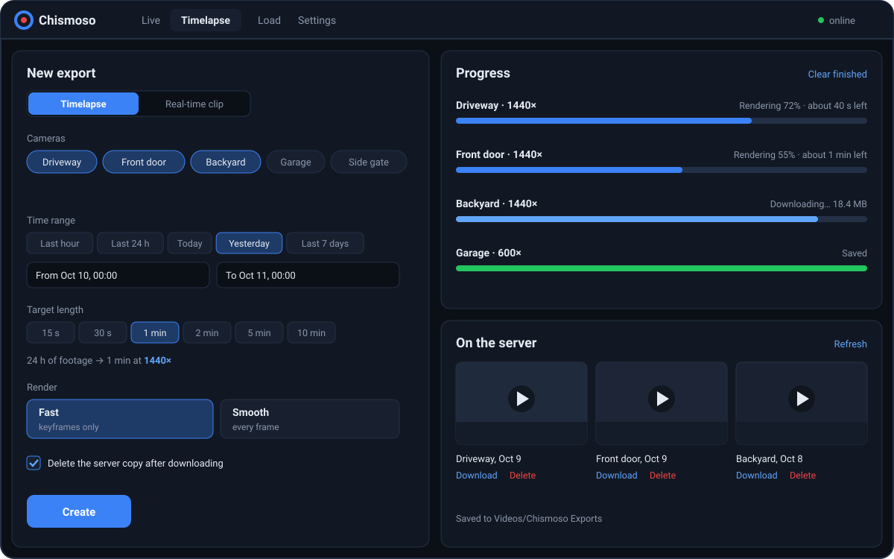

Chismoso can turn any stretch of recordings into a video file: either a **clip** at normal speed or a **timelapse** that squeezes hours into seconds. Frigate does the rendering on the server; Chismoso queues the work, follows the progress, downloads the finished files, and can tidy up afterwards.



## From the timeline

The quickest way: on the [timeline](timeline.md#selecting-a-range), press **✂ Clip** (or <kbd>Shift</kbd>-drag) to select a range, then:

- **Save clip** saves the range at normal speed, one file per camera in view (one in the camera view, every camera in the grid). It starts right away.
- **Timelapse…** opens the Timelapse tab with those cameras and that range filled in, so you can pick a length and speed first.

## From the Timelapse tab

The **New export** form has everything:

1. **Timelapse** or **Real-time clip** at the top.
2. **Cameras**: tick one or more (**All** / **None** to speed things up).
3. **Time range**: set **From** and **To**, or use a preset: *Last hour*, *Last 24 h*, *Today*, *Yesterday*, *Last 7 days*.
4. **Length** (timelapses only), either way round:
   - **Target length**: how long the finished video should be, from 15 seconds to 10 minutes. Chismoso works out the speed.
   - **Speed**: set it directly, anywhere from 2× to 3600×, with presets from 10× to 1440×. **1440× turns a day into a minute.**
5. **Render**: **Fast** or **Smooth** (below).
6. **More options**: the frame rate of the finished video (30 fps by default).
7. **Save to**: the folder downloads go to.
8. **Delete the server copy after downloading**, if you don't want the export to stay on Frigate.

The form shows how long the result will be before you start. Press **Create**.

## Fast or Smooth

| Render | What Frigate decodes | Best for |
|---|---|---|
| **Fast** (default) | Only keyframes, about one every 1–2 seconds of footage | Speeds of 60× and up |
| **Smooth** | Every frame | Slow timelapses, where every frame shows |

At high speeds most frames are thrown away anyway, so Fast looks the same and is many times quicker: in testing, **11× faster** with an identical result. Below 60×, motion can look jumpy with keyframes only, and Chismoso warns you and suggests Smooth.

## Several cameras in parallel

All the cameras you pick are sent to Frigate at once. Frigate renders up to `record.export.max_concurrent` of them at the same time (3 by default); the rest wait their turn. If your server has headroom, raise it in Frigate's config:

```yaml
record:
  export:
    max_concurrent: 4
```

## Following progress

The **Progress** list shows each camera's job: queued, rendering (with a percentage, the elapsed time and an estimate of the time left), downloading, and saved. If Frigate's queue is full, the job waits and says so. **Clear finished** tidies the list.

## Sharing

When a clip or timelapse is saved, its row in **Progress** has:

- **Share…** opens your computer's share menu: Mail, Messages, AirDrop and more on a Mac; the Windows **Share** panel (email, nearby sharing, and apps like WhatsApp) on Windows. Linux desktops don't have a common share menu, so it isn't shown there.
- **Copy** puts the file on the clipboard. Paste it into a chat, an email or a folder and it attaches like any file. On Linux this needs `wl-clipboard` (Wayland) or `xclip` (X11).
- **Play** and **Show in folder**.

**Smaller file for sharing** (under **Save to**) makes Frigate render the video at 720p with stronger compression: usually a fraction of the size, which matters for chat apps with upload limits, and still looks fine on a phone. It needs Frigate 0.17 or newer, and it works for timeline clips too.

Clips listed under **On the server** have **Share…** too: Chismoso downloads the clip to your **Save to** folder first (or uses the copy that's already there), then offers the same choices. Each card also shows the file's size on the server, handy before downloading a long timelapse.

Pictures work the same way: see [Snapshots](camera-view.md#snapshots).

## Where files go

Downloads go to the **Save to** folder. By default that's a **Chismoso Exports** folder in your Videos folder (or Downloads, or your home folder, if there's no Videos folder). Use **Open** to show it in your file manager.

## Exports on the server

**On the server** lists the exports stored on Frigate, including ones made from Frigate's own web page. For each one you can:

- **Play** it inside Chismoso,
- **Download** it to your Save to folder,
- **Delete** it from the server (you'll be asked first).

Exports that are still rendering show as *Rendering…*. Press **Refresh** to update the list.

## Older Frigate versions

Frigate 0.17 and newer accept any timelapse speed. Older versions only offer 25×; Chismoso tells you when that's the case.

## From the command line

The same export engine works without opening the window, for scripts and scheduled jobs. See [Command line](command-line.md).
