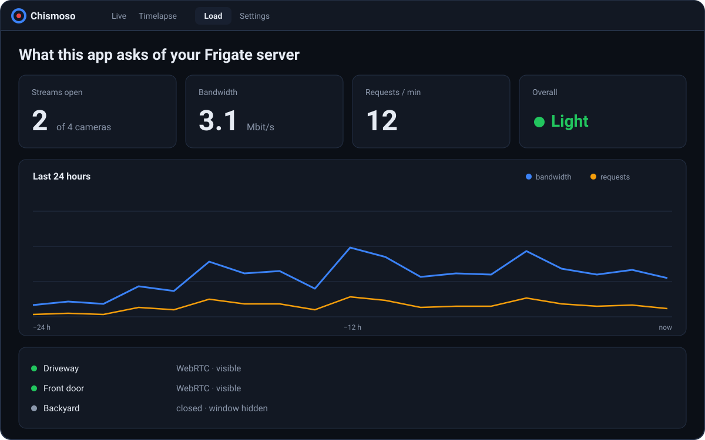

The **Load** tab answers a simple question: how hard is this app making my Frigate server work? It also checks how well this computer is set up to decode video.

## Right now

Updated every five seconds, for the last minute:

- **Requests and data** this app pulls from Frigate.
- **Live streams** this app has open.
- **Frigate's server CPU**.
- **go2rtc viewers** from every client, not just this one, so you can see if a browser tab somewhere is still streaming.

## Trend

Below, the same numbers over the last **1 h**, **6 h** or **24 h**. They're recorded once a minute while the app is open and **kept on this computer** (in the app's local storage, separately for each server). Gaps are times the app was closed. Nothing is sent anywhere.

## This computer

Whether this computer decodes video in **hardware** (graphics card) or **software** (processor), and how:

| System | What the web view uses |
|---|---|
| Windows | WebView2 (Edge), which uses the graphics card when it can |
| macOS | WebKit with VideoToolbox, in hardware |
| Linux | GStreamer, in software unless a hardware plugin is installed |

On Linux, if no hardware plugin is found, the Load screen says what to install. See [Hardware video decoding](install.md#hardware-video-decoding).

## What the app does to stay light

- Live streams close after the window has been minimized or hidden for 30 seconds, and reopen when it's back.
- Tiles scrolled out of view don't stream or fetch snapshots.
- Snapshot tiles ask Frigate for the size they're shown at, not a fixed size.
- Grid playback plays at most four cameras at once; the rest show occasional stills.
- Opening a camera from a live tile reuses the tile's connection.
- The timeline only repaints when something on it moved, and nothing polls while the window is hidden.
