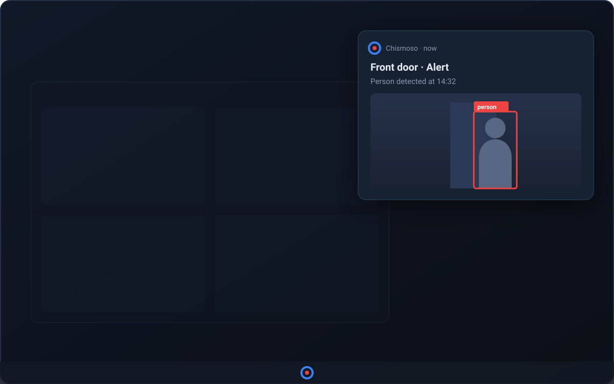

Chismoso can show a native notification whenever Frigate raises a new **alert**, and optionally a **detection**, with a snapshot of who was there.

## Turning them on

Go to **Settings → Notifications** and tick **Notify me about new alerts**. Then choose:

| Setting | Options |
|---|---|
| **Also detections** | Off by default. Detections are far more frequent than alerts, so this can be a lot |
| **Snapshot in the notification** | *When a person is detected* (default), *For every notification*, or *Never* |
| **At most one per camera every** | 10 s, 30 s, **1 min** (default), 5 min or 15 min |
| **Cameras** | Pick the cameras to hear about. None picked means all of them |

Press **Send a test notification** to check that your system lets Chismoso show them.

> [!TIP]
> If the test doesn't appear: on **macOS**, allow Chismoso in **System Settings → Notifications**. On **Windows**, check **Settings → System → Notifications** and Focus. On **Linux**, check your desktop's notification settings and Do Not Disturb.

## The cooldown

A busy camera can raise several alerts a minute. The cooldown makes sure you get **at most one notification per camera** in that time. An event that's upgraded from a detection to an alert still gets through.

## How it works

While the app is running, Chismoso keeps one WebSocket connection open to Frigate's `/ws` endpoint and listens for new review items. That's all it needs:

- **No MQTT broker**, no cloud service, no push relay.
- The same connection keeps open timelines up to date, so new alerts appear on the bar within a couple of seconds.

On desktop the app keeps running in the background, so notifications arrive even when the window is minimized. Close the app and they stop.

On **Windows**, Chismoso registers its own name and icon for notifications when it starts (per user, under `HKCU\Software\Classes\AppUserModelId\org.caprichosos.chismoso`), so notifications say *Chismoso* rather than *Windows PowerShell*, even if you run the `.exe` without installing it.

> [!NOTE]
> On phones (coming soon), notifications will only arrive while the app is open. Background alerts on a phone need push notifications, which aren't set up yet. See [Phone apps](phones.md).
