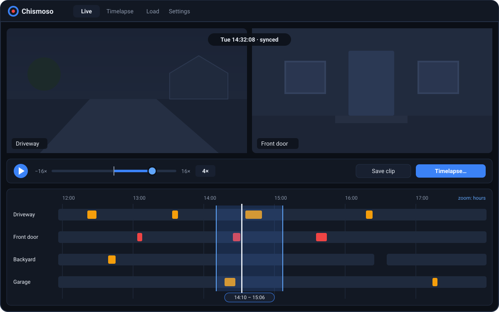

Under the camera grid, and under each camera in the camera view, there's a bar covering your recordings. You can zoom it from weeks down to about twenty seconds, see at a glance where the alerts and detections are, and click anywhere to start playing.

> [!NOTE]
> Playing recordings needs **Frigate 0.17 or newer**. With older versions you can still watch live and make exports.

## Reading the bar

| You see | It means |
|---|---|
|  Blue | Recorded footage |
| Dark gaps | No footage for that time |
|  Red marks | Alerts |
|  Amber marks | Detections |
| Red line | The playhead: the moment you're watching |

In the grid, the bar covers every camera in the view. In the camera view it covers just that camera.

New alerts and detections appear within a couple of seconds, pushed from Frigate as they happen, so you don't need to refresh.

When you zoom out past three days, the bar switches to Frigate's hourly summary. There, brighter blue means more of that hour was recorded.

## Zooming and moving

| Action | What it does |
|---|---|
| Scroll, or pinch on a trackpad or touchscreen | Zoom in or out around the pointer |
| <kbd>+</kbd> / <kbd>-</kbd>, or the **−** / **+** buttons | Zoom in / out |
| **1h**, **6h**, **1d**, **7d** | Show that much time across the bar |
| Drag | Move back and forth in time |
| **Date box** | Jump to a day |

## Playing from a moment

Click anywhere on the bar to play from that moment. If you click in a gap, playback starts at the next footage. In the grid, every camera plays together; see [Playback and speed](playback.md).

Press **● Live** to go back to the live stream.

## Finding events

- **Hover a red or amber mark** to see a thumbnail of the event. Click the thumbnail to play from just before it.
- **⏮ Event** and **Event ⏭** (or <kbd>[</kbd> and <kbd>]</kbd>) jump to the previous or next alert or detection.

## Selecting a range

To work with a stretch of time, press **✂ Clip** and drag across the bar, or hold <kbd>Shift</kbd> and drag. A small panel appears over the selection:

| Button | What it does |
|---|---|
| **▶ Play** | Plays from the start of the selection |
| **Save clip** | Saves the range as a real-time video, one file per camera in view |
| **Timelapse…** | Opens the Timelapse tab with these cameras and this range filled in |
| **✕** | Clears the selection (or press <kbd>Esc</kbd>) |

Saved clips render on Frigate and download to your exports folder; progress shows on the Timelapse tab. See [Clips and timelapses](clips-and-timelapses.md).

## Why it stays fast

The bar asks Frigate for one day of recordings at a time and caches it. Frigate stores recordings as roughly 8,600 ten-second segments a day; Chismoso merges them into a handful of spans before drawing, and only repaints when something on the bar moved.
