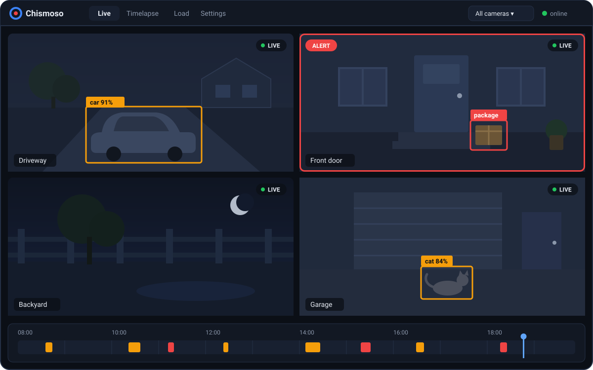

Once you're signed in, Chismoso has four tabs along the top. You can switch between them with the mouse or with <kbd>Ctrl</kbd>+<kbd>1</kbd> to <kbd>Ctrl</kbd>+<kbd>4</kbd> (<kbd>⌘</kbd>+<kbd>1</kbd> to <kbd>⌘</kbd>+<kbd>4</kbd> on a Mac).

## Live

Where you'll spend most of your time. It shows a **grid** of cameras with the **recordings timeline** underneath.

- The **layout** picker at the top chooses which cameras appear: all of them, one of Frigate's camera groups, or a layout of your own. The pencil button next to it edits layouts.
- **Auto / 1 / 2 / 3 / 4** sets the number of columns.
- **Live grid** switches the tiles from snapshots to live video.
- Click a tile to open that camera full size: the [camera view](camera-view.md).
- Click the timeline to [play recordings](playback.md) from any moment, for every camera at once.

Details: [Live view](live-view.md) and [Recordings timeline](timeline.md).

## Timelapse

Make timelapses and real-time clips of one or more cameras, follow their progress, and manage the exports stored on your Frigate server. Clips you save from the timeline show their progress here too. See [Clips and timelapses](clips-and-timelapses.md).

## Load

What this app is asking of your Frigate server right now (requests, data, open streams, server CPU), a 24-hour trend, and whether this computer decodes video in hardware. See [Load screen](load.md).

## Settings

Frigate's system stats, notifications, the per-camera switches, and Frigate's `config.yml` editor. See [Settings](settings.md) and [Notifications](notifications.md).

## The server menu

The server's name at the top right opens a small menu:

| Item | What it does |
|---|---|
| **Open Frigate in browser** | Opens Frigate's own web interface |
| **Full screen** | Fills the screen with the window (<kbd>F11</kbd>) |
| **About** | Version information, with a **Copy version info** button for bug reports |
| **Disconnect** | Signs out and returns to the sign-in screen |

The menu header also shows Frigate's version, your username and your role (admin or viewer).

## Small windows

Make the window narrower than about 700 pixels and Chismoso switches to its compact layout, the same one the phone apps will use. Everything still works; controls just rearrange.
